# Celestial — renderizações reais do Flutter

Prévia a 390 × 884 com fontes e assets locais. Estas imagens são saídas de revisão; não são usadas para implementar a interface.

## Welcome

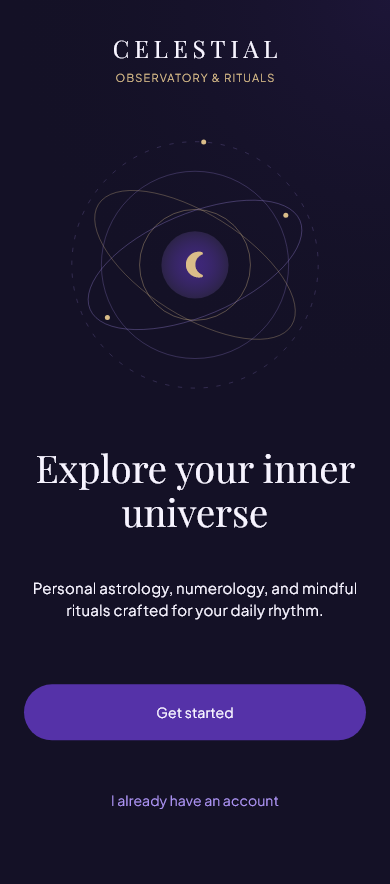

[Referência original](../../design/screens/1._welcome/screen.png) · Rota `/welcome`

## Birth Details

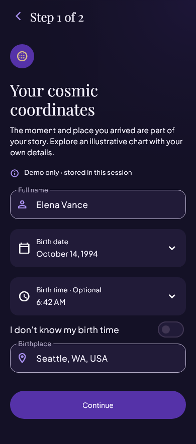

[Referência original](../../design/screens/2._birth_details/screen.png) · Rota `/birth-details`

## Interests

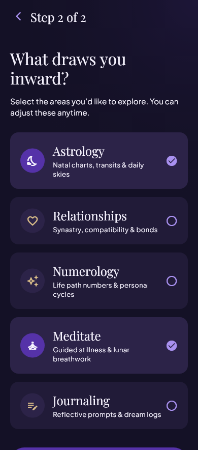

[Referência original](../../design/screens/3._interests/screen.png) · Rota `/interests`

## Home

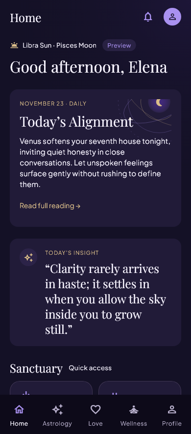

[Referência original](../../design/screens/4._home/screen.png) · Rota `/home`

## Astrology Hub

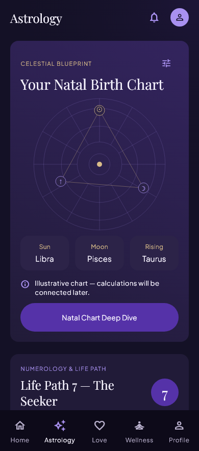

[Referência original](../../design/screens/5._astrology_hub/screen.png) · Rota `/astrology`

## Horoscope Details

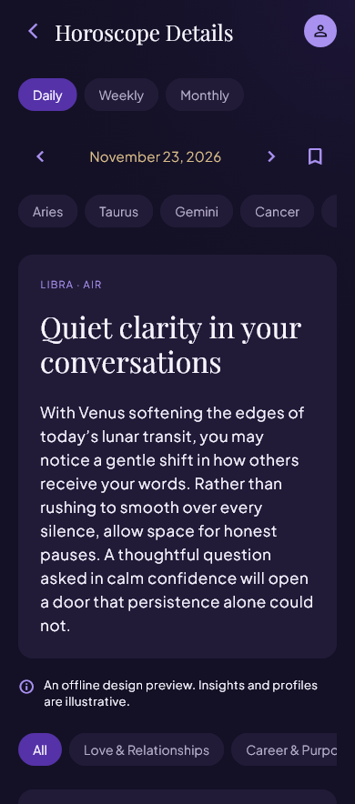

[Referência original](../../design/screens/6._horoscope_details/screen.png) · Rota `/horoscope`

## Love Hub

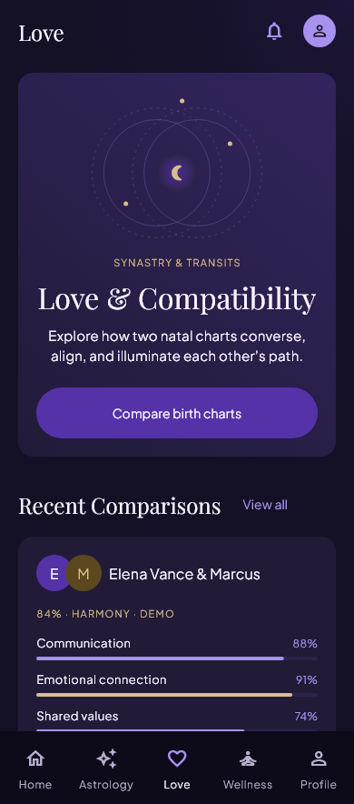

[Referência original](../../design/screens/7._love_hub/screen.png) · Rota `/love`

## Wellness Hub

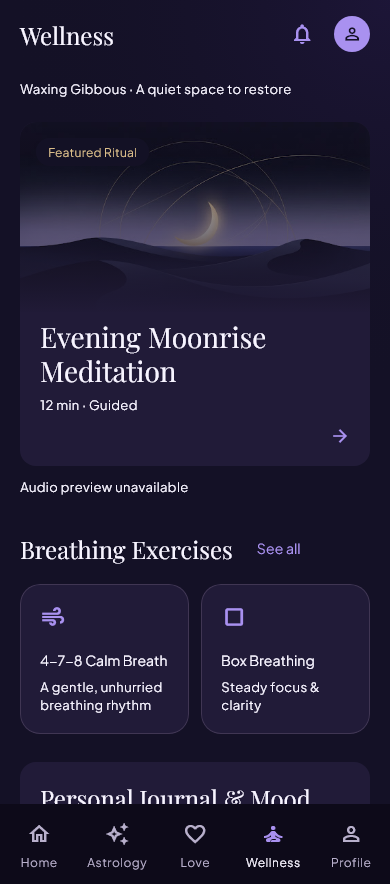

[Referência original](../../design/screens/8._wellness_hub/screen.png) · Rota `/wellness`

## Profile

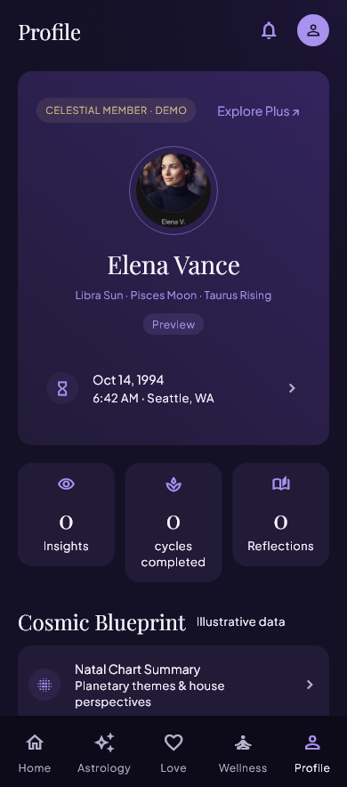

[Referência original](../../design/screens/9._profile/screen.png) · Rota `/profile`

## Cosmic Calendar

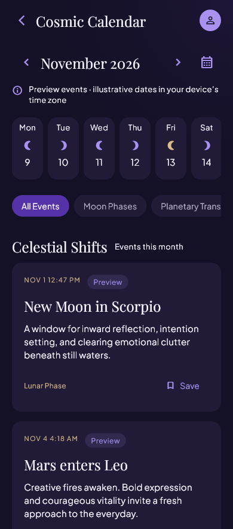

[Referência original](../../design/screens/10._cosmic_calendar/screen.png) · Rota `/calendar`

## Celestial Plus Subscription

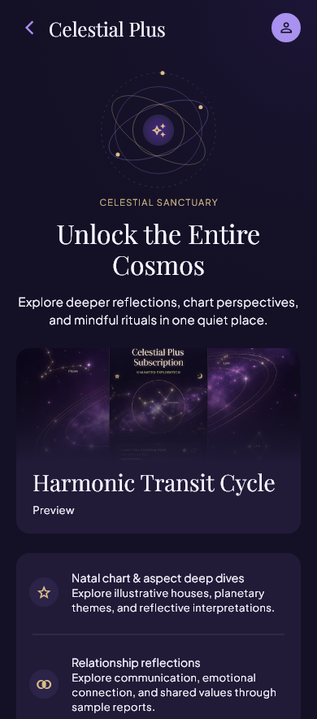

[Referência original](../../design/screens/11._celestial_plus_subscription/screen.png) · Rota `/premium`

## Natal Chart Deep Dive

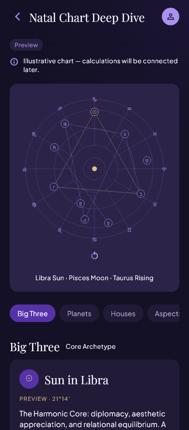

[Referência original](../../design/screens/12._natal_chart_deep_dive/screen.png) · Rota `/birth-chart`
